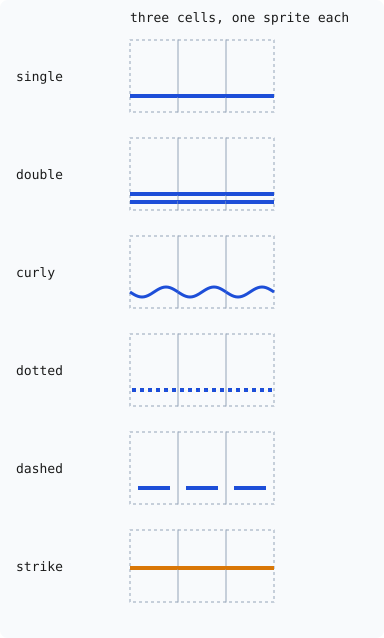

# ADR-102: Cells carry clusters and unresolved colour; glyphs and underlines become sprites

## Summary

- **Decided:** Step 2 of ADR-101, made concrete.
  - **Cells:** a cell holds a glyph key (one codepoint, or a cluster from a reference-counted table), its width, and colours kept as references until render time.
  - **Parser:** reads colon sub-parameters, underline styles, underline colour and strike-through.
  - **Width rules:** grapheme width follows the Unicode rules by default, chosen in kmscon.conf and switched at runtime by DEC mode 2027.
  - **Rendering:** kmscon draws every cell from mask or colour glyph sprites plus one-cell decoration sprites for underline and strike. Colour emoji come through the font library pipeline: FreeType for colour bitmaps and COLRv0, HarfBuzz's rasteriser for COLRv1, scaled once into the cell box.
- **Trades away:**
  - libtsm's draw API and cell layout as upstream ships them.
  - Byte-for-byte agreement with upstream on the tier 1 cases these features touch. Those goldens change deliberately, each in its own commit.
  - A new build dependency on HarfBuzz in the freetype font backend: its shaper for multi-codepoint clusters, and its rasteriser (`libharfbuzz-raster`) for COLRv1 colour glyphs, which FreeType does not draw itself.
- **One-way?** No. Each part lands behind the harness and can be reverted. The cost of reversing grows as later steps (images, the kitty protocol) build on the cell and sprite structures.
- **Probes:**
  - *Confident (width-default):* the default is Unicode rules (a heart with VS16 takes two cells, a ZWJ family is one two-cell glyph), with `grapheme-width=wcwidth` in kmscon.conf for anyone whose programs drift on those lines.
  - *Not confident (colour-formats):* that HarfBuzz's rasteriser, a recent addition to a mature library, is the right painter for COLRv1, and that SVG-only emoji fonts may draw as one-colour shapes. Bitmap, COLRv0 and COLRv1 fonts all draw in colour.
- **Inversion:** Between "port one reference terminal's design" and "invent a new one". The answer takes each part from whichever MIT reference fits a C console with a CPU renderer:
  - foot's per-parameter sub-parameters and its shaping of clusters only;
  - Ghostty's reflow of a cell widened by VS16, and its one-curl-per-cell underline;
  - two glyph formats, as Ghostty and foot have.
  It rejects the parts that don't fit: WezTerm's heap strings and its Unicode-9 default, Ghostty's shaping of every run, and foot's clusters that are never freed.

## Context

ADR-101 decided that the screen model and render path are rebuilt, and that step 2 delivers colour emoji, grapheme clusters and underline styles. It left the concrete shapes open. The code as it stands (libtsm c2feb28, kmscon f8a1a8e) blocks each feature at a specific point:

- **Clusters never form.** `tsm_screen_write` returns early for a codepoint of width 0, so combining marks, ZWJ and variation selectors are dropped. The symbol table can hold sequences, but nothing appends to it. Width comes from the first codepoint's `wcwidth`.
- **Colour is resolved too early.** The parser reduces palette indices 16-255 to RGB (`to_rgb`, `lookup_color`) before the screen stores them, keeping only the 16 base colours as indices, and the draw call hands the renderer final RGB for every cell, so there is nowhere to keep an underline colour that follows the foreground through reverse video.
- **Sub-parameters void the sequence.** A colon puts the parser in its ignore state, so `SGR 4:3` and `58:2::r:g:b` discard the whole SGR. A semicolon `4;58;5;196` sets blink, because 58 is unhandled and the 5 that follows reads as blink. SGR 21, 58 and 59 are unhandled. There is no strike-through attribute. ADR-101 lists strike among the existing bits; it is not there and is added here.
- **Glyphs are alpha only.** A glyph is one byte of alpha per pixel, the blend in drm2d and fbdev mixes foreground over background by that alpha, and the GL atlas is `GL_ALPHA`. The font backend draws the underline into the glyph. `FT_LOAD_COLOR` is never used, so Noto Color Emoji's 109-pixel colour strike is flattened to grey and cropped.
- **The emoji font is reachable.** Noto Color Emoji reports monospace spacing, so kmscon's monospace filter does not exclude it. The missing piece is colour loading.

The cell counts set the budget. At 7680x2160 with an 8x16 cell, the screen is 960x135, about 130,000 cells; a thousand lines of scrollback at that width are 960,000 more. Upstream's internal cell is 32 bytes on 64-bit systems: codepoint, width, a 12-byte attribute struct and an 8-byte age (`uint_fast32_t`).

## Decision

### Parsing (libtsm)

- CSI parameters keep colon sub-parameters, up to 8 per parameter, beside the existing 16 parameters. A colon no longer sends the sequence to the ignore state.
- SGR reads its parameters with their sub-parameters:
  - `4` single underline; `4:0` none; `4:1` single, `4:2` double, `4:3` curly, `4:4` dotted, `4:5` dashed; any other `4:n` gives single, as Ghostty does (foot turns underline off instead; single keeps the program's evident intent visible). `21` double underline. `24` no underline.
  - `9` strike-through, `29` not strike-through.
  - `38`, `48` and `58` take a colour in any of these forms: `:5:n`, `;5;n`, `:2:r:g:b`, `:2::r:g:b` (the empty colour-space slot of ITU T.416), `:2:cs:r:g:b`, and `;2;r;g;b`. The semicolon form always takes exactly three values, as xterm documents it. Sub-parameters after `b` in the colon forms (T.416's unused, tolerance and tolerance colour space fields) are accepted and ignored. `:2:r:g:b` is not in T.416; foot and Ghostty accept it, and so does this fork. `58` sets the underline colour, and `59` returns it to following the foreground.
  - A parameter with sub-parameters SGR does not know is skipped on its own. The rest of the sequence still applies.
- The Linux VT once read SGR 21 as normal intensity. This fork follows ECMA-48 and every current terminal: 21 is double underline.

### Colour (libtsm)

- A colour is stored as one of: default, palette index (0-255), or RGB. The cell holds three: foreground, background and underline. Underline's default means "whatever kmscon is configured to use", which is the foreground unless kmscon.conf says otherwise (see Underline and strike).
- Resolution moves to the draw path. Palette lookup, bold-as-bright, dim, reverse video (cell, screen and selection) and the cursor are applied when the renderer asks for a frame. Reverse video swaps foreground and background.
- The kitty underlines doc says an underline colour that was set stays the same under reverse video, and one that was not follows the foreground. libtsm reports the underline colour as set (resolved to RGB) or default (a flag, with the resolved foreground beside it). kmscon decides what a default underline draws in: the foreground, or its configured `underline-color`, which is a set colour for this purpose and does not swap under reverse video.

### Cells and clusters (libtsm)

- A cell holds:
  - a 32-bit glyph key;
  - its width (0 for the trailing half of a wide cell, 1 or 2);
  - the three colours;
  - the attribute bits: bold, italic, dim, blink, inverse, protect, strike, and a 3-bit underline style;
  - its age.
  Attributes stay inline, with no interned style table. The cell packs into 32 bytes, the size upstream's cell already has on 64-bit systems, so the screen and scrollback cost what they cost today.
- A glyph key below 2^21 is a codepoint. Above that, it is a cluster id into a table of codepoint sequences, interned by content, at most 32 codepoints each (extenders past 32 are dropped).
  - Each table entry counts the cells that reference it. Writing, erasing, scrolling out of the scrollback limit, resizing or resetting a cell releases its reference, and an entry at zero is freed and its id reused.
  - The table therefore holds only what is on screen or in scrollback, however long the console runs.
- Segmentation follows UAX #29 extended grapheme clusters, applied as text is printed.
  - A printed codepoint joins the cell the previous print wrote when the break rules say the cluster continues.
  - Cursor movement and control characters reset the segmentation state, as foot does; SGR and other sequences that do not move the cursor leave it alone, so a colour change inside a cluster does not split it. After a reset, a zero-width codepoint (a combining mark, ZWJ or variation selector) still joins the cell before the cursor rather than being dropped, which is also foot's behaviour; any other codepoint starts a new cell.
- The break properties, Extended_Pictographic, East Asian Width, Emoji_Presentation and the emoji variation sequences come from tables generated from the Unicode Character Database.
  - The generator script is committed, and its Unicode version is pinned. The pin and the regenerated tables change only in their own commit.
  - No runtime Unicode library is added.

### Width

- **Two methods.**
  - `unicode`, the default:
    - a cluster's width comes from its first codepoint by East Asian Width and Emoji_Presentation;
    - VS16 makes a cluster wide when its base is listed in the emoji variation sequences; for any other base it is kept in the cluster and changes nothing;
    - VS15 never changes width, as the mode 2027 draft specifies; it changes only presentation;
    - a ZWJ sequence takes the width of its first codepoint, which for emoji sequences is wide. Regional indicators have Emoji_Presentation, so a flag is wide by the first-codepoint rule.
  - `wcwidth`:
    - only zero-width codepoints join the cell before them (combining marks, ZWJ, variation selectors);
    - every codepoint with width starts its own cell, at its per-codepoint width (East Asian Width and Emoji_Presentation, from the same pinned tables as the `unicode` method);
    - the cursor lands where programs that count per codepoint expect it. A program's libc may carry a different Unicode version than the tables, so agreement is close but not guaranteed; the bundled wcwidth table libtsm carries today is replaced by the generated tables, so one build has one Unicode version.
- `grapheme-width=unicode|wcwidth` in kmscon.conf chooses the method a new terminal starts with.
- DEC private mode 2027 switches it while the terminal runs (set is `unicode`, reset is `wcwidth`). DECRQM replies 1 (set) or 2 (reset) for the current method; the draft leaves the values to DECRQM's own definition.
- The draft has a soft reset (DECSTR) and a hard reset (RIS) return the mode to undefined, that is, off. This fork deviates on purpose: both resets return to the method kmscon.conf configures, because that setting is the reader's choice for their fonts and programs (operator, on the config option). The deviation ends if the fork drops the setting.
- **A VS16 that widens a placed cell** widens it in place. When the cell sat in the last column, the cluster moves to the start of the next line, and the cell it left is cleared, as a wide character at the margin is placed today. VS15 never narrows a placed cell.

### Drawing interface (libtsm to kmscon)

- `tsm_screen_draw2` is replaced by a frame call. It returns, per visible cell:
  - the glyph key and width;
  - resolved foreground and background, and the underline colour as set (RGB) or default;
  - the attribute bits;
  - whether the cell changed since the last frame.
  It also gives a way to read a cluster key's codepoints. The cursor is part of the frame, and kmscon no longer builds the cursor cell itself.
- The age machinery inside libtsm stays the source of "changed".
- `tsm_screen_draw`, the callback API that `tsm-replay` and other programs use, is kept. For the attributes upstream has, it reports what it reports today, including palette indices 16-255 as RGB with code -1. The new attributes reach it through the attribute struct's added fields, which callers built against upstream never read.

### Glyphs (kmscon)

- **Glyph format.** A glyph has a format and a width in cells. The format is an A8 mask, tinted with the foreground, or premultiplied ARGB32, drawn as it is. Colour glyphs ignore the foreground, and synthetic bold and italic are not applied to them.
- **Glyph cache key.** The cache is keyed by the codepoint sequence, not the cluster id, plus bold, italic and width. Cluster ids are reused, so a key built from an id could return the wrong glyph.
- **Loading.**
  - A single codepoint is loaded by glyph index, as today. A cluster of more than one codepoint is shaped with HarfBuzz on the chosen face, and its glyphs are drawn into one sprite.
  - Shaping only clusters keeps HarfBuzz off the path that draws plain text. Shaping is required for correctness: Noto Color Emoji reaches its ZWJ, flag and keycap glyphs only through OpenType substitutions, which FreeType does not apply. HarfBuzz becomes a required dependency of the freetype backend. pango already depends on it, and Arch's freetype2 lists it as optional, so most systems have it, but a freetype-only build gains it.
  - Faces with colour load with `FT_LOAD_COLOR`. A bitmap-only face uses its fixed strike nearest the cell height. The strike is scaled once, with a box filter, into a box of one or two cells: fit to the height, then shrunk to the width if it is wider. The scaled sprite is cached, never the strike.
  - Glyphs follow the font library pipeline, with no painter of the fork's own:
    - fontconfig chooses the face.
    - HarfBuzz chooses the glyphs for a cluster.
    - FreeType draws what it draws itself: outlines as masks, colour bitmaps, and COLRv0 layers.
    - For COLRv1, FreeType supplies only the paint data. Those glyphs are painted by HarfBuzz's rasteriser (`hb_raster_paint`, in `libharfbuzz-raster`), which renders COLRv0 and COLRv1 into BGRA32 with the cell's foreground available for glyphs that use it. HarfBuzz is MIT-licensed and already required for shaping, so this adds no new project.
    - SVG glyphs are not rendered: FreeType hands SVG documents to a renderer the program registers, and this record registers none. An SVG-only emoji font (Twemoji Mozilla is the common one) draws as outlines in a mask.
- **Presentation and fallback.**
  - A cluster is emoji presentation when it carries VS16 on a base listed in the emoji variation sequences, or when its first codepoint has Emoji_Presentation and it carries no VS15. The same table gates width and presentation, so a colour glyph is never squeezed into a narrow cell by an unlisted VS16.
  - For an emoji-presentation cluster the fallback search asks fontconfig for a colour face covering the codepoint first. That one query bypasses the monospace filter.
  - Text-presentation clusters prefer faces without colour.
  - The primary font list keeps the monospace filter.

### Underline and strike (kmscon)

The figure shows each underline style as one cell-wide sprite repeated across three cells: one period of the curly wave per cell, starting and ending at the same height, and dots and dashes spaced so neighbouring cells join.

- **Decoration sprites.** Underline styles (single, double, curly, dotted, dashed) and strike-through are A8 decoration sprites, one cell wide. They are generated per style, cell size and font metrics, and tinted at draw time, so any colour applies without a new sprite.
- **Decoration colours.**
  - kmscon.conf sets the colour each decoration takes when no program has chosen one: `underline-color` and `strike-color`. Each takes `fg` (the default: follow the cell's foreground), a palette index 0-255, or `#rrggbb`.
  - A palette index resolves through the palette in use, so it follows a palette change.
  - For underlines, SGR 58 overrides the configured colour on the cells it applies to, and SGR 59 returns them to it.
  - No escape sequence sets a strike colour, so strike always takes the configured one.
  - `force-decoration-colors=on` makes the configured colours win over SGR 58. It exists for accessibility: a reader who cannot distinguish the colour a program picked, or who runs a high-contrast palette, can make every underline and strike the colour they can see. Programs are not told; the cells keep the colour the program set, and only the drawing changes.
- **Colour emoji under accessibility settings.**
  - `emoji-color=off` draws every cluster in text presentation: from a face without colour, as a mask tinted with the foreground, so it follows the palette and the reader's colour settings like any other text.
  - A codepoint no face covers in text presentation still draws from the colour face, as a mask taken from the colour glyph's alpha.
- **Joining across cells.** Every sprite tiles: curly is one period per cell starting and ending at the same height, dotted and dashed divide the cell so neighbours join, and a wide cell takes the sprite twice.
- **Metrics.**
  - Position and thickness come from the font's underline position and thickness (the `post` table). When the thickness is zero it is estimated from the cell height, and the result is clamped inside the cell.
  - Double and curly take the space below the single line.
  - Strike sits at the font's strikeout position, or at half the x-height when the font has none.
- **Draw order.** A cell draws its background, then its underline, then its glyph, then its strike. Descenders overlap the underline.
- The font backend no longer draws underlines into glyphs.

### Backends and renderers (kmscon)

- **Blend operations.** drm2d and fbdev gain a second blend: premultiplied ARGB source over the destination, applied after the cell background is filled. The existing alpha-mask blend stays for masks.
- **bbulk** draws the frame from the cell list. Its per-cell damage comes from the frame's changed flag, in place of comparing the previous frame's cells.
- **gltex** gains an RGBA atlas beside the alpha atlas, a shader path that samples colour without tinting, and decoration sprites in the alpha atlas. Both atlases are fixed in size and evict the least recently used glyph that is not on screen. gltex lands after bbulk and is gated on tier 3, where its variant is outside the default run until #17 is resolved.

### Order of work and the harness

Each item lands behind the conformance harness (ADR-301), with goldens changed only in their own commits:

1. **Parser.** Sub-parameters, SGR 4:x, 9, 21, 29, 58, 59, colon colour forms.
   - `tsm-replay` prints underline style, underline colour and strike only when they are set, and reads them only where the fork's headers declare them (a feature macro), so it still builds against upstream v4.8.0 and `make golden REF=v4.8.0` keeps working. That rebuild is a gate of this step: the goldens it writes for the preserved cases must equal the committed ones.
   - `tsm-replay` raises its codepoints per cell from 8 to 32, to match the cluster limit, and fails loudly if a cluster is longer than it can print.
   - `sgr-underline-extended` changes deliberately: no blink; curly, double, dotted and dashed styles; an underline colour.
   - New cases cover each colour form and the skipped unknown sub-parameter.
2. **Colour as references.** No golden changes. Tier 1 and tier 2 stay exact while resolution moves to the draw path.
3. **Clusters and width.** The `combining` and `emoji` goldens change deliberately. New cases cover VS16 widening at the margin, VS16 on an unlisted base, VS15 leaving width alone, both width methods, mode 2027 with DECRQM and both resets, a combining mark after cursor movement, cluster reuse after erase, and scrollback release.
4. **kmscon glyph format, RGBA blend and decoration sprites.**
   - New tier 2 screens: each underline style and colour, strike, combining marks, a colour emoji, a ZWJ sequence, a flag, and VS16 and VS15 pairs.
   - Tier 2 pins a colour emoji font in the tree: a subset of Noto Color Emoji (SIL OFL 1.1) holding the test's glyphs, like the CJK subset it already carries.
5. **Tier 3 screens** for the same features, on the 2D variants.
6. **gltex.**

Each step's code reads the specifications and the MIT references above. Anything adapted from Ghostty, WezTerm, foot or fcft names its source and licence in the file and the commit (ADR-300).

## Consequences

### Positive

- `SGR 4:3` and `58:2::r:g:b` work, and the blink that `4;58;5;196` turns on today is gone.
- Emoji draw in colour at the right size, and ZWJ sequences, flags and keycaps draw as one glyph.
- Combining marks stay with their base instead of disappearing.
- Underline colour follows reverse video correctly, because colours resolve at render time.
- A reader can set underline, strike and emoji colours for accessibility, including over colours programs choose, without programs knowing.
- The ASCII path never shapes and never touches the cluster table.
- The cluster table cannot grow without bound on a console that runs for months.
- The sprite cache and the two glyph formats are the structures step 3 (images) composites with.

### Negative

- Programs that count with `wcwidth` drift on lines with VS16 or ZWJ emoji under the default. The config setting and mode 2027 are the remedy, and they have to be documented.
- The freetype backend requires HarfBuzz, a new dependency for builds without pango.
- Glyph caches hold larger colour sprites. A wide emoji at 8K font sizes is twice a cell of ARGB.
- The tier 1 goldens for the touched cases stop matching upstream by design, so the record of what changed deliberately has to be kept carefully.
- HarfBuzz's rasteriser is recent, though HarfBuzz itself is the shaper Chrome, Firefox and Android use. A fault in its COLRv1 painting would show in the tier 2 screens, which pin a colour font.
- SVG-only colour fonts draw as outlines.

### Neutral

- The generated Unicode tables pin a Unicode version. Moving it is a deliberate commit with its own golden review.
- The pango font backend is not changed by this record. It keeps drawing as it does, and colour support there is a separate question.
- Strike-through, absent until now despite ADR-101's list, is added with the same mechanism as underline.

## Alternatives Considered

- **Interned style table per page (Ghostty).** It saves memory per cell, but needs reference counting on every attribute change. Inline attributes cost what the upstream cell costs today, and the console's cell count is small enough not to need it.
- **Per-row underline ranges (foot).** These keep the cell small, but every write and erase has to split and merge ranges. Underline style is 3 bits in the cell.
- **Clusters interned forever (foot), or per-page arenas (Ghostty).** Interning forever grows without bound over a long-lived console. Per-page arenas fit Ghostty's page allocator, which libtsm does not have. Reference counts on a single table fit libtsm's line and scrollback structure.
- **Keep full segmentation across cursor movement (Ghostty).** This needs the previous cell's break state rebuilt after any movement, for a case programs rarely produce. foot's rule, reset segmentation on movement but still attach zero-width codepoints, keeps combining marks with their base at less cost.
- **Narrow a cell on VS15 (Ghostty).** The mode 2027 draft says VS15 changes presentation and not width, and narrowing reflows a line programs have already laid out.
- **Never widen a placed cell (WezTerm at its Unicode-9 default).** This leaves a VS16 heart in one cell. The `wcwidth` method covers anyone who wants that.
- **wcwidth as the default.** Considered and offered. The operator chose a kmscon.conf setting, with Unicode rules as its default.
- **A COLRv1 painter of the fork's own (WezTerm), or rejecting COLRv1 (fcft).** The operator asked to follow the font library pipeline instead, and HarfBuzz's rasteriser paints COLRv1 from inside that pipeline.
- **cairo's FreeType font support.** It renders COLRv1, and possibly SVG, and is two decades mature. Rejected: it is a new dependency (LGPL or MPL), pulls in the X11 client libraries on Arch, which is heavy for a recovery console, and its colour glyph renderer is its newest part. HarfBuzz's rasteriser covers the same COLR formats with a dependency the backend already has. The operator agreed to the switch.
- **Shape every run with HarfBuzz (Ghostty, WezTerm).** This costs shaping on every frame and needs a shaping cache. Only clusters need shaping for correctness.
- **A runtime Unicode library (utf8proc, libunistring).** Either adds a dependency to a console that runs before most of userspace. Generated tables are small, versioned and reviewed like goldens.
- **Draw underlines as geometry (foot).** This avoids an atlas on the CPU path, but gltex would then need a second path. Sprites serve both renderers.
- **One RGBA atlas for everything (WezTerm).** This quadruples the memory of plain text glyphs. Two formats keep text at one byte per pixel.
