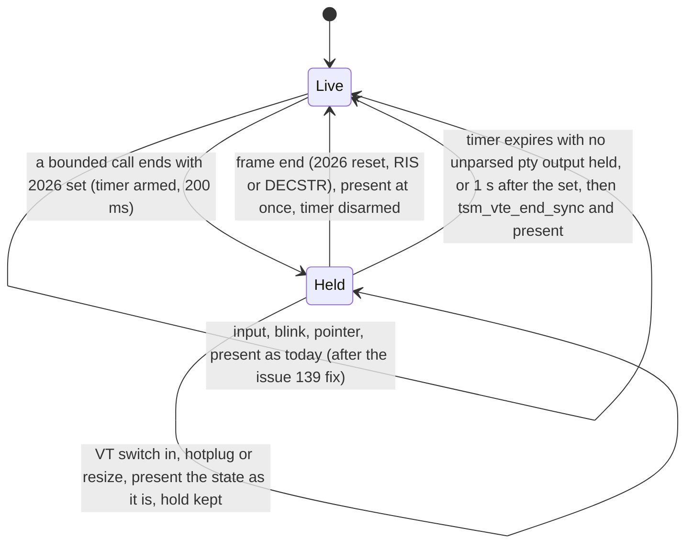

# ADR-201: One mode registry in libtsm, and synchronized output (mode 2026)

## Summary

- **Decided:**
  - **Registry.** Every mode libtsm recognises is one row of `src/tsm/tsm-modes.def`, an X-macro table: number, ANSI or DEC, name, status (supported, partial, ignored, refused), default and the resets that restore it, whether the host must act, the terminfo capabilities that advertise it, the spec, and the tests. SM/RM dispatch, DECRQM replies, resets, a public mode query and a generated reference page all expand from it.
  - **Lint.** Four checks in libtsm's `make test` fail when a mode is handled outside the registry, a supported row names no test that exercises it, or the generated page is stale. kmscon's capability runner reads the registry's generated table and fails when a mode the host must act on has no probe, or a mode with terminfo capabilities is missing from `kmscon.ti`.
  - **Mode 2026.** libtsm keeps parsing during a hold and stops a bounded input call right after the reset that ends a frame. kmscon presents only states in which mode 2026 is reset, and presents at once at each frame end. A hold expires 200 ms after it began, set by `sync-timeout` in `kmscon.conf`; kmscon then ends it through libtsm, so DECRQM reports it reset.
  - **Without 2026.** On top of #139's fix, kmscon also declines to build a frame while it is still part way through a program's write, at most one display refresh interval in a row. A keystroke's echo draws at once.
- **Trades away:**
  - Echo of typed keys during a hold waits for the frame end or the timeout, up to 200 ms.
  - Without 2026, bulk output presents up to one refresh interval later.
  - When a program finishes frames faster than the display flips, kmscon shows the latest complete frame and drops the ones between.
  - A mode change costs a registry row, a test and a regenerated page in the same change.
  - `csi_mode` is rewritten whole. Tier 1 and the unit tests guard the rewrite; it is the riskiest step.
  - DECRQM starts answering for 33 modes. Programs that probe modes at startup take new paths on kmscon.
- **One-way?** No. The registry is internal to libtsm. The public additions are a mode query, a frame-end counter and a call that ends a hold. Reversal becomes expensive once programs depend on kmscon's DECRQM replies and Sync capability.
- **Probes:**
  1. *Confident (one-list):* you wanted one list of mode support that the code is held to. The list is libtsm's table with its generated page; kmscon's probes and terminfo checks are tested against it. Is that the place you meant?
  2. *Not confident (stall):* when a program starts a synchronized frame and then stalls, the screen freezes for up to the timeout before showing what it has. Is a short freeze the failure you would rather see than a torn frame?
- **Inversion:** Between "present every state the parser reaches" (today: lowest latency, torn frames) and "present only what the program declares complete" (2026 kept strictly: a stalled program freezes the console). The answer honours a declaration for a bounded time and leaves undeclared output presenting as it arrives, coalesced at most to the display's refresh.

## Context

ADR-200 surveys mode handling. libtsm recognises 32 mode numbers in two `switch` statements in one function; their state is spread across a flag word, the screen's flags, mouse fields that hold mode numbers, named booleans and the screen's width method; defaults are written in three places, and mode 2004 has none. DECRQM answers only mode 2027. Nothing lists which modes exist, which have tests, or which kmscon must act on, and kmscon's probes and terminfo entry are hand-kept beside them. The operator asked for "a lintable list of mode support in code ... that we can find all the mode support for".

kmscon draws after every bounded input call, each at most one 16384-byte read, so a program's frame larger than one read is presented part written. The torus diagnosis measured up to 13 320 mixed cells in one present at 384x54 (ADR-200). Mode 2026 is how programs (neovim, tmux, many TUI libraries) declare frame boundaries, and the operator called it "worth supporting". It needs both repositories: the mode and its report in libtsm, the hold in kmscon's presentation.

## Decision

### The registry (libtsm)

`src/tsm/tsm-modes.def` holds one row per mode libtsm recognises:

```c
/* MODE(kind, number, name, status, dflt, reset, host, terminfo, spec, tests) */
MODE(ANSI, 4,    IRM,     SUPPORTED, false, RESET_SOFT, HOST_NONE,  "",            "ECMA-48, IRM",                 "test_vte_irm")
MODE(DEC,  2,    DECANM,  REFUSED,   true,  RESET_NONE, HOST_NONE,  "",            "ctlseqs; VT52 is not emulated", "")
MODE(DEC,  2004, BRPASTE, SUPPORTED, false, RESET_SOFT, HOST_PASTE, "BD BE PS PE", "ctlseqs, bracketed paste",     "test_vte_paste")
MODE(DEC,  2026, SYNC,    SUPPORTED, false, RESET_SOFT, HOST_DRAW,  "Sync",        "contour synchronized-output",  "test_vte_sync_frame test_vte_sync_bounded")
```

The row values above illustrate the columns; the first implementation step fills the table from the code as it behaves.

- **kind** `ANSI` (no `?`) or `DEC` (`?`). **number** and **name**: the mnemonic names the row's accessors.
- **status**:
  - `SUPPORTED`: set and reset do what the spec says. DECRQM replies 1 or 2.
  - `PARTIAL`: part of it; the spec column names the missing part's issue. DECRQM replies 1 or 2.
  - `IGNORED`: accepted with no effect. Either nothing on a console can apply (printer modes 18 and 19, smooth scroll 4) or an effect is wanted and the spec column names its issue (KAM, DECARM, DECNRCM, DECCOLM). DECRQM gives the row's fixed state: 4 (permanently reset) or 3 (permanently set), and only where that state is true of the terminal. An IGNORED row keeps the legacy `TSM_VTE_FLAG_*` bit upstream's `tsm_vte_get_flags` exposes where it has one (KAM, DECARM, DECNRCM), toggling on SM/RM as before (ADR-303).
  - Every DECRQM answer describes what the terminal actually does: never "reset" while the behaviour is active, never "permanently" for a state that can change, and 0 where the truth cannot be computed. Mode 12 (cursor blink) is therefore `PARTIAL`: DECRQM answers 1 or 2 from whether the current DECSCUSR style blinks, and 2 when the host turns blinking off (`tsm_vte_set_cursor_blink`, which kmscon sets from `blink`); SM/RM 12 do nothing yet (libtsm#57). (Changed 2026-10-25: the operator picked "Truthful, else unknown" when asked whether DECRQM answers must match actual behaviour, answering 0 where they can't. This item read: "IGNORED: … or an effect is wanted and the spec column names its issue (KAM, DECARM, DECNRCM, DECCOLM, mode 12). DECRQM gives the row's fixed state: 4 (permanently reset) or 3 (permanently set).")
  - `REFUSED`: deliberately not implemented, with the record or issue that says why (DECANM: VT52). DECRQM gives the fixed state.
  - A number with no row is unknown: SM/RM log it at debug level, as now, and DECRQM replies 0.
- **dflt** and **reset**: the state after `tsm_vte_new`, and which resets restore it: `RESET_SOFT` (DECSTR and RIS), `RESET_HARD` (RIS only, as for 80, 1070 and 8452), `RESET_NONE`. A host-configured default (1070, 2027) names the vte field that holds it.
- **host**: whether the embedding program must act for the mode to have its effect: `HOST_NONE`, `HOST_INPUT` (mouse modes, 1004), `HOST_PASTE` (2004), `HOST_DRAW` (2026).
- **terminfo**: the capabilities that advertise the mode, from ncurses user_caps(5) and tmux(1), or empty.
- **spec**: the reference: ctlseqs section, ECMA-48 clause, the contour spec, or an ADR.
- **tests**: one or more test names: a `START_TEST` in `test/*.c` or a tier 1 case in `test/conformance/cases.list`.

Each `SUPPORTED` and `PARTIAL` row has two accessors in `tsm-vte.c`, `mode_<name>_set(vte, bool)` and `mode_<name>_get(vte)`. Their bodies are hand-written, since a mode's effect is code: 1049 switches buffers and moves the cursor, 2027 changes the width method. The table generates their declarations, so a row without accessors fails to compile and an accessor without a row is unused and warned.

From the table, by `#include` with `MODE` defined each time:

1. **Dispatch.** `csi_mode` becomes two generated `switch` statements, one per kind, each case calling the row's setter, or doing nothing for `IGNORED` and `REFUSED`.
2. **DECRQM.** `mode_report(vte, kind, number)` returns the DECRPM value 0 to 4. The `$p` branch replies `CSI ? Ps ; Pm $ y` or `CSI Ps ; Pm $ y` to every query, unknown numbers included, as xterm does (0: not recognised). `csi_decrqm_2027` goes.
3. **Reset.** `tsm_vte_reset` and `tsm_vte_hard_reset` restore every row whose reset matches, through its setter. Mode 2004 gains a reset as a result.
4. **Host query.** `int tsm_vte_get_mode(struct tsm_vte *vte, bool dec, unsigned int number)` returns the same 0 to 4 value, so a host asks what a program would ask. `tsm_vte_get_flags` and `tsm_vte_get_mouse_mode` stay for compatibility; the unused private `FLAG_*` copy in `tsm-vte.c` goes.
5. **The page.** `test/gen-modes.c`, built with the tests, includes the table and prints `fork/modes.md`, the reference page (one table per kind: number, name, status, DECRQM reply, default, reset, host, terminfo, spec, tests), and `fork/modes.tsv`, the same rows for other tools. `make modes` rewrites both.

X-macros keep the table, the code and the page in one file with no code generator in the build: the C preprocessor expands the table into code, and the page comes from a test program that includes the same table.

XTSAVE and XTRESTORE are outside this decision; with the table, each becomes a loop over rows. Until then `CSI ? Pm r` is dropped, where today it reaches DECSTBM and resets the scroll region (ADR-200).

### The lint (libtsm `make test`)

Four meson tests, each seen red once against a planted defect before it is trusted (ADR-301):

1. **modes-sweep** (C). For every DEC number 0 to 65535 and every ANSI number 0 to 255: DECRQM replies 0 exactly when the table has no row. For each number with no row, `h` then `l` leaves the screen, the cursor, the flags and every row's report unchanged. A handler added outside the table changes state and fails here.
2. **modes-source** (Python, beside `test/conformance/check.py`). `csi_mode` and the `$p` branch consist of the table's expansions; no `case` with a numeric literal or a mode constant appears in them; the mode constants (`TSM_VTE_MOUSE_MODE_*`, `TSM_VTE_BRACKETED_PASTE`) appear only in the table and the accessors.
3. **modes-tests**. Every `SUPPORTED` row names a test that exists. With the trace build, a test-only counter in the generated dispatch records each row's set and reset, and every `SUPPORTED` row must be set and reset by a test it names. `PARTIAL` rows must name a test that exists. (The operator chose this strictness; see the answers below.)
4. **modes-doc**. Regenerates `fork/modes.md` and `fork/modes.tsv` and fails on any difference, printing `make modes`.

### What kmscon draws from the registry

kmscon reads `fork/modes.tsv` from the pinned subproject; `tests/capabilities/run.py` adds three verdicts to the four in its README:

- every row with a host value other than `HOST_NONE` and status `SUPPORTED` or `PARTIAL` has a probe named `mode-<number>` or `mode-<number>-<detail>` in `capabilities.list` (the mouse and paste probes are renamed to fit);
- a `works` mode probe names a `SUPPORTED` or `PARTIAL` row; a `missing` one names no row or an `IGNORED` row;
- each row's terminfo capabilities become a generated probe `terminfo-mode-<number>`, which the list must name like any other. A newly supported mode with terminfo capabilities therefore fails until `kmscon.ti` advertises them or the list records them missing against an issue. The hand-written `terminfo-bracketed-paste`, `terminfo-sgr-mouse`, `terminfo-sync` and `terminfo-focus` become these.

`COVERAGE.md` links the generated page for modes instead of restating them. #94's mode half (`BD`, `BE`, `PS`, `PE`, `XM`) is then driven by the table.

### Mode 2026 in libtsm

- **Set** (`CSI ? 2026 h`) starts a hold. libtsm keeps parsing and applying everything, replies included, as the spec requires. A set during a hold changes nothing and does not extend it.
- **Reset** (`CSI ? 2026 l`) during a hold ends a frame. RIS, DECSTR and the host's end call end one too.
- **Frame-end stop.** `tsm_vte_input_bounded` returns right after the byte that ended a frame, as it returns when its image work is spent (ADR-103), so the host sees the completed frame before any byte of the next. `tsm_vte_input`, which returns nothing, parses through.
- **Frame-end counter.** `tsm_vte_get_sync_frames(vte)` counts frame ends; a host compares it across a call to learn that one happened.
- **Host end.** `tsm_vte_end_sync(vte)` ends a hold as a reset would. After it, DECRQM replies 2.
- **DECRQM** replies 1 during a hold and 2 otherwise.

### Mode 2026 in kmscon

kmscon presents a screen state only when mode 2026 is reset, with two exceptions: the hold has expired, or the display has lost the last presented picture (a VT switch back in, a display hotplug or mode set, a resize). Then it draws the state as it is.



The figure shows when kmscon presents: a hold begins when a bounded input call leaves mode 2026 set, and ends at a frame end or when the timer expires; display events draw through a hold without ending it.

- **Frame end.** When the frame-end counter advances across a bounded call, kmscon redraws at once, before the pty hands back the rest of its buffer, unless a flip is in flight (next item).
- **During a hold** every other redraw request (pty input, the blink timers, the pointer, the render timer's overlay) records that a redraw is owed and returns before building a frame, at the same early exit #139 adds for a pending flip.
- **A flip in flight.** A draw deferred to the page flip checks the hold again when the flip arrives. If a hold has begun since, it waits for the next frame end. A frame that ends while a flip is in flight is replaced by the next complete one, and kmscon never stalls the pty for presentation.
- **Timeout.** One timer per terminal, armed at the `sync-timeout` setting (milliseconds in `kmscon.conf`, default 200) when a bounded call leaves the mode set and no timer is armed, disarmed at a frame end. At expiry, if the pty still holds unparsed output kmscon has read, the frame end may be in it, so the expiry waits until that output is parsed, up to 1 s after the hold began, or the timeout when it is set longer. Then kmscon calls `tsm_vte_end_sync` and presents.
- **Why 200 ms.** Implementations use 150 ms (Alacritty, Rio), 200 ms (st's appsync patch) and 1 s (wtmux); the spec sets none and says a too-short timeout is no worse than none (ADR-200). kmscon parses and presents on one thread, on machines as small as ADR-103's one-vCPU tier 3 guest, so a large frame takes it longer to take in than a desktop terminal with its own render thread; 200 ms covers a program drawing at 5 frames a second. A stalled program's screen shows its partial state within a fifth of a second.
- **VT switch.** In the background nothing draws, as now; the hold and its timer run on. Switching back draws the state as it is: the display no longer holds the last complete frame, and the hold continues.
- **Damage.** Unchanged. Each display's `tsm_frame_age` collects every change since its last present (ADR-102), so the present after a hold damages the union of the held changes.
- **Bounded feed.** Unchanged apart from the frame-end stop. A hold never stops kmscon reading the pty, and the image work bound applies during a hold.
- **Input.** Keys are handled during a hold; their echo shows at the frame end or at expiry.
- **Render timer** (ADR-103). Two counts join its line and overlay: redraws owed to a hold (`held`) and holds that expired (`expired`). An expired hold is logged once per hold at debug level.
- **Displays.** One hold per terminal. Each display presents at the frame end, or at its own next flip if one is in flight.

### Coalescing without mode 2026

#139 is fixed separately: kmscon stops building a frame it will not present, by checking for a pending flip or scheduling the redraw before the frame is built. That removes the wasted walk; a frame presented part way through a write is still presented. This proposal adds one condition at the point #139's fix decides whether to build a frame, and changes nothing else in it.

kmscon also declines to build a frame while it is part way through a program's write: the loop turn parsed at least 16384 bytes of the program's output, or the pty still holds output the bounded feed has not parsed. It builds one at the first redraw request that finds neither, or once one display refresh interval has passed since the last present, whichever comes first; when the output began to arrive after that interval had passed, as after an idle spell, the interval is counted from when it began. The wait adds at most one refresh interval. A redraw requested by a key press, for its echo, builds a frame at once.

(Changed 2026-10-25, the signal: the paragraph's premise read "the last read filled the 16384-byte buffer". The review of step 6 found that a Linux pty hands its reader at most 4095 bytes a read, the size of n_tty's buffer, so a read never fills kmscon's 16384 bytes and the signal never fired: on a real pty a 6 MB write took 2292 reads, none of 16384 bytes. The operator chose "Bytes this turn: a turn that read at least N bytes in total holds up to one refresh". N is 16384, measured in `tests/test_present.c` against 4095 and a screen's worth, 24000 bytes at the test's 120x30 cells. At 4095, output of 4 to 16 KB, such as a page of a shell's output, waited up to a refresh. At 24000, frames written as 16 KB calls still presented part written, 533 mixed cells per present as without coalescing. At 16384 those frames presented whole and output under 16 KB a turn presented at once.)

(Changed 2026-10-25, the idle spell: counting from when the output began after an idle spell was chosen by the team lead during step 6, within the operator's bound "at most one refresh skipped part way through a write", and goes to the operator in the step's PR. Counting only from the last present drew the first turn of every write that follows an idle spell at once: with the kernel's read sizes, frames written as 16 KB calls 50 ms apart presented 522 mixed cells per present, against 533 without coalescing and 0 with this rule. The sentence read: "It builds one at the first redraw request that finds neither, or once one display refresh interval has passed since the last present, whichever comes first.")

- **Gains:** fewer frames presented part written for programs that do not use mode 2026, when the program writes a frame faster than kmscon reads it; a large sixel shows whole more often; output such as `cat` of a large file presents at the display's refresh rate.
- **Costs:** up to one refresh interval of delay during bulk output (interactive echo, and output under 16384 bytes a turn, present at once); a frame written in pieces of under 16384 bytes a turn, more slowly than kmscon reads, still tears, so the heuristic narrows the mixing without removing it; and a complete write of 16384 bytes or more that ends a turn waits up to one refresh, since the rule cannot tell it from one still arriving. It is a guess at boundaries the program never declared.
- **Measured** with PR #141's `test_present` and the torus capture: mixed cells per present and presents per second, before and after. Step 6 measured with `test_present`'s schedules, on a fake clock with the kernel's read sizes and on a real pty; the torus capture was not available to it (PR #201).

### Testing (ADR-301)

- **libtsm units:** set, reset, set during a hold, DECRQM in each state, the bounded call stopping right after a frame end while `tsm_vte_input` parses through, RIS and DECSTR ending a hold, `tsm_vte_end_sync`, and the counter.
- **Tier 1:** a case with frames bracketed in 2026 and a DECRQM in the middle of a frame.
- **kmscon:** `tests/test_present.c` (PR #141) gains a schedule with every frame bracketed in mode 2026 and kmscon's present rules, with presents after every read; no presented frame may be part written. A fake clock drives the timer: expiry, the wait for held output, the 1 s cap, VT switch and resize during a hold.
- **Probes:** `mode-2026-sync` and `terminfo-mode-2026` (`Sync`) become `works`; `decrqm` becomes `works` with step 2.
- **Tier 3:** a screen that draws large frames in 2026 at 7680x2160 and passes only if no capture shows a mixed frame.

### Order of work

Each step lands behind the harness, with goldens changed only in their own commits.

1. **libtsm registry.** The table filled from today's behaviour, the accessors, the generated dispatch, resets and page, and the modes-source and modes-doc checks. Tier 1 unchanged. Mode 2004's reset and the `CSI ? r` fix (libtsm#44) follow in their own commits with tests.
2. **libtsm reports.** DECRQM for every row (libtsm#31, first item), `tsm_vte_get_mode`, modes-sweep and modes-tests.
3. **libtsm mode 2026** (libtsm#21, libtsm half): the row, the frame-end stop, the counter and `tsm_vte_end_sync`.
4. **kmscon checks.** The pin; `run.py` reading `modes.tsv`; probe renames and the generated terminfo probes.
5. **kmscon hold.** The present rule, the timer, the render timer counts, and the tests above. Closes libtsm#21 with `terminfo-mode-2026` once `kmscon.ti` gains `Sync`.
6. **Coalescing without 2026**, after #139's fix lands, measured as above.

## Consequences

### Positive

- One file answers which modes libtsm knows, what each does, whether it is tested, and what a program will be told when it asks; a check fails when code and table disagree.
- DECRQM answers every query, so programs can detect features on kmscon (libtsm#31).
- Reset defaults come from the table, which fixes mode 2004 surviving RIS and makes a missing default impossible to write.
- Programs that use mode 2026 never show a part-written frame on kmscon, at any frame size.
- kmscon's probes and terminfo entry are checked against what libtsm supports; #94 and future terminfo gaps fail a check.
- XTSAVE and XTRESTORE, and focus reporting (libtsm#29), become small additions to a table.

### Negative

- Rewriting `csi_mode` touches every mode at once; step 1 must leave every golden unchanged.
- Each mode change carries a row, a test and a regenerated page.
- A program that sets 2026 and stalls freezes the console for up to 200 ms, or up to 1 s while kmscon is behind on its output.
- Typed keys echo up to 200 ms late inside a hold.
- Frames between flips are dropped during a hold.
- The `.def` file is less readable than a YAML table; the generated page is what people read.

### Neutral

- libtsm's public API gains `tsm_vte_get_mode`, `tsm_vte_get_sync_frames` and `tsm_vte_end_sync`; each is offered upstream with the registry.
- The answers to DECRQM change what programs that probe modes do on kmscon at startup; tier 1's recorded program streams may need re-recording, in their own commits.

## Alternatives Considered

### For the registry

- **A hand-kept list in the docs.** Rejected: nothing fails when code and list disagree, which is the state today.
- **A YAML or TSV table with a Python generator that writes C.** Equivalent in single-sourcing, and easier to read. Rejected for adding a code generator to libtsm's build, which today needs only meson and a C compiler; X-macros need only the preprocessor.
- **A runtime array of structs** (number, kind, setter, getter) searched at dispatch. Workable, and debuggable. The X-macro can fill such an array too; the switch it generates keeps dispatch as it is, and the declarations it generates make a missing accessor a compile error.
- **Extracting the list from the existing `switch` statements with a script.** Rejected: it documents the code without changing it, gives no DECRQM, and breaks on the first restructured case.
- **The registry in kmscon.** Rejected: libtsm parses modes and answers DECRQM, and other libtsm hosts need the same table.

### For mode 2026

- **Buffer the raw bytes during a hold and parse them at the reset** (Alacritty's first implementation, with a 2 MiB cap). Rejected: replies to queries in the middle of a frame (DSR, DECRQM) would wait for the frame end, and the spec says the terminal keeps processing.
- **Snapshot the screen when a hold begins and draw the snapshot.** Rejected: the display already holds the last presented frame, so nothing needs copying.
- **Stall the pty at a frame end until the flip** (backpressure). Every complete frame would be shown, at the cost of tying the program's pace to the display and to every display's flip. Rejected for now; revisited if dropped frames show in tier 3.
- **No timeout.** Rejected: a program that dies in a frame leaves the console frozen until something resets the terminal, and a console has no other window to recover from.
- **On expiry, keep the mode set and ignore it until the next set.** Rejected: DECRQM would report 1 while the screen updates live.
- **Present on a vblank-driven loop for all output.** A larger change to kmscon's event model that wakes the CPU every refresh; mode 2026, #139's fix and the proposed coalescing address the visible defect and the wasted walk without it.

## Questions for the operator

1. **Timeout.** The draft holds a frame for at most 200 ms, then shows what the program has drawn. Other terminals use 150 ms (Alacritty, Rio) up to 1 s (wtmux). Is 200 ms right for the console, and should it be a `kmscon.conf` setting?
2. **Coalescing without 2026.** Programs that do not declare frames would still tear on large writes. Should kmscon also hold back a present while it is still reading one big write, at most one display refresh in a row, at the cost of up to one refresh of delay during bulk output? Or should undeclared output keep presenting as it arrives?
3. **How strict the test check is.** Proposed: every supported mode must name a test, and that test must actually turn the mode on and off. Looser: the named test only has to exist. Stricter: partial modes too, and every DECRQM reply checked by a test. Which?

## Operator answers (2026-10-23)

Relayed by the team lead; each followed the draft's recommendation, and the Decision above is written to match.

1. **Timeout:** 200 ms, configurable as a `kmscon.conf` setting (`sync-timeout`).
2. **A stall inside a synchronized frame:** a brief freeze. The last complete frame stays until the frame ends or the timeout fires.
3. **Coalescing without 2026:** yes, with at most one refresh skipped part way through a write; a keystroke's echo still draws at once.
4. **Test check:** each supported mode's named test sets and resets it.

## Note (2026-10-23): the terminfo column covers standard capabilities

The registry's terminfo column names every capability whose string sets or resets the mode, the standard ones included, beside the extensions. On today's rows: mode 5 has `flash`, mode 25 `civis` and `cnorm`, mode 1049 `smcup` and `rmcup` (`kmscon.ti:58`, `:71`, `:74`; ADR-200's corrections). Their generated `terminfo-mode-<number>` probes pass from the start. What was decided is unchanged.
