# Conformance run 2026-10-22

**What this run marks:** Step 2.4b renderer, libtsm erase and frame-age fixes, run pages; session of 2026-10-22

This page records one run of the kmscon fork's conformance harness ([how it works](../../../fork/conformance.md), [ADR-301](../../../architecture/fork/ADR-301-gate-rendering-changes-on-a-three-tier-conformance-harness.md)). Every case compares what the fork produced with a golden, the expected result committed after a person reviewed it, and passes when the two match exactly, or within a tolerance committed beside the golden (a *near* pass).

| Repository | Commit measured |
|---|---|
| kmscon | `22263be` |
| libtsm | [`06331b1`](https://github.com/aaronsb/libtsm/commit/06331b1) |

| Tier | What it checks | Cases passing |
|---|---|---|
| [Tier 1: screen state](#tier-1-screen-state) | the cell grid libtsm's parser produces | 53 of 53 |
| [Tier 2: pixels in memory](#tier-2-pixels-in-memory) | the renderer's pixels, drawn in memory | 14 of 14 |
| [Tier 3: end to end](#tier-3-end-to-end) | the installed package on a real KMS device | 10 of 10 |

Tools: dev image `ee205c220399`, Arch Linux Archive 2026/10/21, fontconfig 2:2.18.3-2, freetype2 2.15.0-1, gcc 16.2.1+r23+gd564253eb6c8-1, harfbuzz 14.6.0-1, meson 1.12.1-2, pixman 0.46.4-1.

## Since the previous run

The previous ledger run is [2026-10-21](https://github.com/aaronsb/kmscon/blob/627f3d1/docs/conformance/sheets/2026-10-21-2862aeb-c2feb28.svg), "Tier 3 joins: installed package in a KVM guest, 2D variants": kmscon `2862aeb`, libtsm `c2feb28`.

| Tier | Then | Now |
|---|---|---|
| 1 | 26 of 26 | 53 of 53 |
| 2 | 6 of 6 | 14 of 14 |
| 3 | 10 of 10 | 10 of 10 |

- **Newly failing:** none.
- **Newly passing:** none.
- **New cases:** tier 1: [`sgr-color-forms-fg`](#sgr-color-forms-fg-tier-1-pass), [`sgr-color-forms-bg`](#sgr-color-forms-bg-tier-1-pass), [`sgr-color-forms-ul`](#sgr-color-forms-ul-tier-1-pass), [`sgr-underline-styles`](#sgr-underline-styles-tier-1-pass), [`sgr-strike`](#sgr-strike-tier-1-pass), [`sgr-underline-color-reset`](#sgr-underline-color-reset-tier-1-pass), [`sgr-subparam-unknown`](#sgr-subparam-unknown-tier-1-pass), [`sgr-color-colon-out-of-range`](#sgr-color-colon-out-of-range-tier-1-pass), [`sgr-color-semicolon-subparams`](#sgr-color-semicolon-subparams-tier-1-pass), [`colour-resolve`](#colour-resolve-tier-1-pass), [`sgr-58-semicolon-no-blink`](#sgr-58-semicolon-no-blink-tier-1-pass), [`sgr-subparam-overflow`](#sgr-subparam-overflow-tier-1-pass), [`csi-subparam-non-sgr`](#csi-subparam-non-sgr-tier-1-pass), [`emoji-sequences`](#emoji-sequences-tier-1-pass), [`vs16-widen`](#vs16-widen-tier-1-pass), [`vs16-margin`](#vs16-margin-tier-1-pass), [`vs16-unlisted-base`](#vs16-unlisted-base-tier-1-pass), [`vs15-width`](#vs15-width-tier-1-pass), [`width-methods`](#width-methods-tier-1-pass), [`mode-2027-decrqm`](#mode-2027-decrqm-tier-1-pass), [`mode-2027-resets`](#mode-2027-resets-tier-1-pass), [`combining-after-move`](#combining-after-move-tier-1-pass), [`cluster-reuse-erase`](#cluster-reuse-erase-tier-1-pass), [`cluster-max`](#cluster-max-tier-1-pass), [`prepend-width`](#prepend-width-tier-1-pass), [`vs16-insert-mode`](#vs16-insert-mode-tier-1-pass), [`insert-wide-one-column`](#insert-wide-one-column-tier-1-pass); tier 2: [`combining`](#combining-tier-2-pass), [`deco-config`](#deco-config-tier-2-pass), [`deco-force`](#deco-force-tier-2-pass), [`redraw`](#redraw-tier-2-pass), [`strike`](#strike-tier-2-pass), [`underline`](#underline-tier-2-pass), [`vs16`](#vs16-tier-2-pass), [`wide-deco`](#wide-deco-tier-2-pass).
- **Removed cases:** none.
- **Goldens changed:** tier 1: [`sgr-basic`](#sgr-basic-tier-1-pass), [`sgr-underline-extended`](#sgr-underline-extended-tier-1-pass), [`wide-chars`](#wide-chars-tier-1-pass), [`combining`](#combining-tier-1-pass), [`emoji`](#emoji-tier-1-pass), [`prog-tmux`](#prog-tmux-tier-1-pass); tier 3: [`2d-1280x800/sgr`](#2d-1280x800sgr-tier-3-pass), [`2d-7680x2160/sgr`](#2d-7680x2160sgr-tier-3-pass).

The previous run left no per-case record. A case counts as passing then when the previous run passed every case of its tier, and as new when its golden was added since; a removed case is a golden deleted since.

## Tier 1: screen state

libtsm, the terminal-state library kmscon draws from, replays a byte stream (synthetic escape sequences, or a recorded session of a real program) and dumps the screen it ends with as text: each cell's character and attributes, and the cursor. A case passes when the dump equals its golden dump. Where the fork keeps upstream libtsm's behaviour the golden comes from upstream; where it changed the behaviour on purpose the golden comes from a fork commit, and the last column gives the reason ([fork-goldens.list](https://github.com/aaronsb/libtsm/blob/06331b1/test/conformance/fork-goldens.list)).

| Case | Size | Verdict | Golden from |
|---|---|---|---|
| [`sgr-basic`](#sgr-basic-tier-1-pass) | 80×24 | pass | fork: SGR 9 sets strike |
| `sgr-extended-color` | 80×24 | pass | upstream |
| [`sgr-underline-extended`](#sgr-underline-extended-tier-1-pass) | 80×24 | pass | fork: 4:x styles and 58 colours apply; 4;58;5;196 no longer blinks |
| `sgr-color-forms-fg` | 80×24 | pass | fork: colon colour forms for 38 |
| `sgr-color-forms-bg` | 80×24 | pass | fork: colon colour forms for 48 |
| `sgr-color-forms-ul` | 80×24 | pass | fork: SGR 58 in every colour form |
| `sgr-underline-styles` | 80×24 | pass | fork: 4:0-4:5, unknown style, 21, 24 |
| `sgr-strike` | 80×24 | pass | fork: 9 and 29 |
| `sgr-underline-color-reset` | 80×24 | pass | fork: 59, 24 and SGR 0 against the underline colour |
| `sgr-subparam-unknown` | 80×24 | pass | fork: unknown sub-parameters skipped alone |
| `sgr-color-colon-out-of-range` | 80×24 | pass | fork: colon index or component above 255 rejected |
| `sgr-color-semicolon-subparams` | 80×24 | pass | fork: semicolon form with sub-parameters consumes nothing |
| `colour-resolve` | 80×24 | pass | fork: colours, dim and reverse with underline colours (ADR-102 step 2) |
| `sgr-58-semicolon-no-blink` | 80×24 | pass | fork: 58 consumes its 5 |
| `sgr-subparam-overflow` | 80×24 | pass | fork: sub-parameters past eight dropped |
| `csi-subparam-non-sgr` | 80×24 | pass | upstream |
| `cursor-motion` | 80×24 | pass | upstream |
| `erase` | 80×24 | pass | upstream |
| `erase-display-above` | 20×6 | pass | upstream |
| `insert-delete` | 80×24 | pass | upstream |
| `scroll-region` | 20×8 | pass | upstream |
| `origin-mode` | 20×8 | pass | upstream |
| `autowrap` | 10×4 | pass | upstream |
| `tabs` | 80×24 | pass | upstream |
| [`wide-chars`](#wide-chars-tier-1-pass) | 12×4 | pass | fork: a wide character with one column left wraps; it is not cut at the margin |
| [`combining`](#combining-tier-1-pass) | 80×24 | pass | fork: combining marks join their base cell |
| [`emoji`](#emoji-tier-1-pass) | 80×24 | pass | fork: one cell per emoji sequence; VS16 widens the heart |
| `emoji-sequences` | 80×24 | pass | fork: ZWJ family, flag, keycap, skin tone: one cell each |
| `vs16-widen` | 80×24 | pass | fork: VS16 widens a placed cell |
| `vs16-margin` | 10×4 | pass | fork: VS16 in the last column moves the cluster down |
| `vs16-unlisted-base` | 80×24 | pass | fork: VS16 on an unlisted base changes nothing |
| `vs15-width` | 80×24 | pass | fork: VS15 never changes width |
| `width-methods` | 80×24 | pass | fork: unicode and wcwidth on the same text |
| `mode-2027-decrqm` | 80×24 | pass | fork: DECRQM replies for mode 2027 |
| `mode-2027-resets` | 80×24 | pass | fork: RIS and DECSTR return to the configured method |
| `combining-after-move` | 80×24 | pass | fork: a mark after cursor movement joins the cell before it |
| `cluster-reuse-erase` | 80×24 | pass | fork: clusters erased and printed again |
| `cluster-max` | 80×24 | pass | fork: a 33-codepoint cluster keeps 32 |
| `prepend-width` | 80×24 | pass | fork: a Prepend mark starts a cluster with width |
| `vs16-insert-mode` | 8×2 | pass | fork: VS16 widening in insert mode shifts the line |
| `insert-wide-one-column` | 1×3 | pass | fork: insert mode with wide cells on a one-column screen |
| `alt-screen` | 20×4 | pass | upstream |
| `replies` | 80×24 | pass | upstream |
| `dec-graphics` | 80×24 | pass | upstream |
| `osc-sequences` | 80×24 | pass | upstream |
| `dcs-sixel` | 80×24 | pass | upstream |
| `apc-kitty-graphics` | 80×24 | pass | upstream |
| `scrollback` | 20×5 | pass | upstream |
| `reset` | 20×4 | pass | upstream |
| `prog-shell` | 80×24 | pass | upstream |
| `prog-less` | 80×24 | pass | upstream |
| `prog-vim` | 80×24 | pass | upstream |
| [`prog-tmux`](#prog-tmux-tier-1-pass) | 80×24 | pass | fork: cells tmux's status line erases take its background colour only, not its foreground |

### `sgr-basic` (tier 1): pass

The golden changed since the previous run (`-` then, `+` now):

```diff
--- previous golden
+++ golden
@@ -10,2 +10,3 @@
 attr 0 38-44 inverse
+attr 0 54-59 strike
 row 1 |fg30 fg31 fg32 fg33 fg34 fg35 fg36 fg37|
```

### `sgr-underline-extended` (tier 1): pass

The golden changed since the previous run (`-` then, `+` now):

```diff
--- previous golden
+++ golden
@@ -4,3 +4,8 @@
 row 0 |curly double boldcurly redulnocolor ul196 ulnone|
-attr 0 36-40 underline blink
+attr 0 0-4 underline=curly
+attr 0 6-11 underline=double
+attr 0 13-21 bold underline=curly
+attr 0 23-27 underline ul=#ff0000
+attr 0 28-34 underline
+attr 0 36-40 underline ul=#ff0000
 row 1 ||
```

### `wide-chars` (tier 1): pass

The golden changed since the previous run (`-` then, `+` now):

```diff
--- previous golden
+++ golden
@@ -3,5 +3,5 @@
 flags AUTO_WRAP
-row 0 |漢字テスト|
-row 1 |ＡＢＣ|
-row 2 |0123456789A漢|
+row 0 |ＡＢＣ|
+row 1 |0123456789A|
+row 2 |漢|
 row 3 |ab한국어|
```

### `combining` (tier 1): pass

The golden changed since the previous run (`-` then, `+` now):

```diff
--- previous golden
+++ golden
@@ -3,3 +3,3 @@
 flags AUTO_WRAP
-row 0 |e a nx o lead|
+row 0 |é ã̀ n̈x o̲̲ ́lead|
 row 1 ||
```

### `emoji` (tier 1): pass

The golden changed since the previous run (`-` then, `+` now):

```diff
--- previous golden
+++ golden
@@ -1,5 +1,5 @@
 size 80x24
-cursor 67,0
+cursor 62,0
 flags AUTO_WRAP
-row 0 |smile 😀 | vs16 ❤ | text ❤ | zwj 👨👩👧 | flag 🇺🇸 | tone 👍🏽 | end|
+row 0 |smile 😀 | vs16 ❤️ | text ❤ | zwj 👨‍👩‍👧 | flag 🇺🇸 | tone 👍🏽 | end|
 row 1 ||
```

### `prog-tmux` (tier 1): pass

The golden changed since the previous run (`-` then, `+` now):

```diff
--- previous golden
+++ golden
@@ -33,3 +33,4 @@
 attr 23 4-10 fg=0 bg=2 underline
-attr 23 11-79 fg=0 bg=2
+attr 23 11-49 bg=2
+attr 23 50-79 fg=0 bg=2
 checkpoint 1014
@@ -68,3 +69,4 @@
 attr 23 4-10 fg=0 bg=2 underline
-attr 23 11-79 fg=0 bg=2
+attr 23 11-49 bg=2
+attr 23 50-79 fg=0 bg=2
 checkpoint 2475
@@ -128,3 +130,4 @@
 attr 23 4-8 fg=0 bg=2 underline
-attr 23 9-79 fg=0 bg=2
+attr 23 9-49 bg=2
+attr 23 50-79 fg=0 bg=2
 checkpoint 2557
@@ -190,3 +193,4 @@
 attr 23 4-8 fg=0 bg=2 underline
-attr 23 9-79 fg=0 bg=2
+attr 23 9-49 bg=2
+attr 23 50-79 fg=0 bg=2
 checkpoint 3878
@@ -254,3 +258,4 @@
 attr 23 4-8 fg=0 bg=2 underline
-attr 23 9-79 fg=0 bg=2
+attr 23 9-49 bg=2
+attr 23 50-79 fg=0 bg=2
 checkpoint 3981
@@ -320,3 +325,4 @@
 attr 23 4-8 fg=0 bg=2 underline
-attr 23 9-79 fg=0 bg=2
+attr 23 9-49 bg=2
+attr 23 50-79 fg=0 bg=2
 checkpoint 4165
```

## Tier 2: pixels in memory

kmscon's renderer (bbulk, through the real drm2d blend) draws each screen into memory with pinned fonts, and the image is compared pixel by pixel with its golden. No display or GPU is involved, so these cases run in every `make test`.

| Case | Verdict | Pixels differing |
|---|---|---|
| [`ascii`](#ascii-tier-2-pass) | pass | 0 |
| [`bold`](#bold-tier-2-pass) | pass | 0 |
| [`box`](#box-tier-2-pass) | pass | 0 |
| [`cjk`](#cjk-tier-2-pass) | pass | 0 |
| [`combining`](#combining-tier-2-pass) | pass | 0 |
| [`deco-config`](#deco-config-tier-2-pass) | pass | 0 |
| [`deco-force`](#deco-force-tier-2-pass) | pass | 0 |
| [`inverse`](#inverse-tier-2-pass) | pass | 0 |
| [`palette`](#palette-tier-2-pass) | pass | 0 |
| [`redraw`](#redraw-tier-2-pass) | pass | 0 |
| [`strike`](#strike-tier-2-pass) | pass | 0 |
| [`underline`](#underline-tier-2-pass) | pass | 0 |
| [`vs16`](#vs16-tier-2-pass) | pass | 0 |
| [`wide-deco`](#wide-deco-tier-2-pass) | pass | 0 |

### `ascii` (tier 2): pass

Printable ASCII in the regular face: a pangram in both cases, digits and punctuation, runs of narrow and wide letters, and a line of code. Correct: every glyph whole and inside its own cell, with columns aligned down the screen.

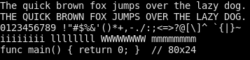

*The screen this run drew, identical to the golden. Cropped to 0,0–357,87 of the 384×160 screen.*

### `bold` (tier 2): pass

Bold beside regular, a bold pangram over two lines, and bold in red, green and blue. Correct: the bold text drawn in the bold face at the same cell width, the coloured words in their colours.

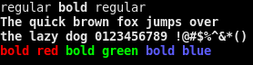

*The screen this run drew, identical to the golden. Cropped to 0,0–278,72 of the 384×160 screen.*

### `box` (tier 2): pass

Box drawing in light and double lines, shades and block elements, eighth blocks, and rounded, heavy and diagonal pieces. Correct: lines join from cell to cell with no gaps, and blocks fill their cells.

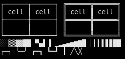

*The screen this run drew, identical to the golden. Cropped to 0,0–256,120 of the 384×160 screen.*

### `cjk` (tier 2): pass

Double-width Japanese, Chinese and Korean, full-width Latin, narrow letters between wide characters, and wide text in bold and in reverse. Correct: each wide character takes two cells and the narrow letters between them keep their own columns.

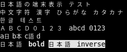

*The screen this run drew, identical to the golden. Cropped to 0,0–251,104 of the 384×160 screen.*

### `combining` (tier 2): pass

Accented letters precomposed and as a base letter with combining marks, in words, underlined, struck and in bold, shaped by HarfBuzz. Correct: each mark sits on its base letter in one cell, matching the precomposed form.

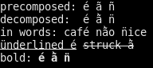

*The screen this run drew, identical to the golden. Cropped to 0,0–192,85 of the 384×160 screen.*

### `deco-config` (tier 2): pass

Underline and strike with the configured colours (underline-color=196, strike-color=#00c0ff), beside SGR 58 colours and coloured text. Correct: underlines and strikes without an SGR 58 colour take the configured colours; an SGR 58 colour still applies.

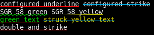

*The screen this run drew, identical to the golden. Cropped to 0,0–312,72 of the 384×160 screen.*

### `deco-force` (tier 2): pass

The deco-config screen with force-decoration-colors set. Correct: every underline and strike in the configured colour, the SGR 58 ones included.

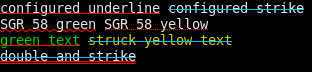

*The screen this run drew, identical to the golden. Cropped to 0,0–312,72 of the 384×160 screen.*

### `inverse` (tier 2): pass

Reverse video (SGR 7): one word, a whole line, red on green swapped, and bold with reverse. Correct: foreground and background exchanged, so the swapped word is green on red.

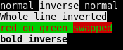

*The screen this run drew, identical to the golden. Cropped to 0,0–175,72 of the 384×160 screen.*

### `palette` (tier 2): pass

The 16 ANSI background colours, the 16 foreground colours on letter pairs, a ramp through the 256-colour palette, and a 24-bit gradient from red to green. Correct: each block filled edge to edge in its own colour, with no gaps between cells.

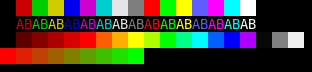

*The screen this run drew, identical to the golden. Cropped to 0,0–312,72 of the 384×160 screen.*

### `redraw` (tier 2): pass

Two frames into the double-buffered display: the second rewrites line 2 and adds a struck line 4, and both buffers must then hold it. Correct: line 2 reads 'line 2 CHANGED curly' with nothing left of the first frame's text.

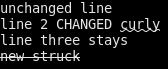

*The screen this run drew, identical to the golden. Cropped to 0,0–168,69 of the 384×160 screen.*

### `strike` (tier 2): pass

Strike-through (SGR 9) alone, in colour, on a background, with straight and curly underlines, in bold, in reverse, and over spaces. Correct: a line through the middle of every struck cell, the spaces included.

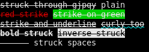

*The screen this run drew, identical to the golden. Cropped to 0,0–248,88 of the 384×160 screen.*

### `underline` (tier 2): pass

Each underline style (single, double, curly, dotted, dashed) in the text colour and in an SGR 58 colour, over descenders; a red curl ended by SGR 59; underlines on a background, in reverse and in bold. Correct: the five styles distinct, the coloured ones in their SGR 58 colour, and the line after SGR 59 in the text colour.

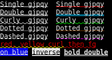

*The screen this run drew, identical to the golden. Cropped to 0,0–224,120 of the 384×160 screen.*

### `vs16` (tier 2): pass

A heart with VS16 (two cells), with no selector and with VS15 (one cell each), and the VS16 heart underlined. Correct: the b after the VS16 heart one column further right; until colour glyphs land, that heart is the text glyph centred in its two cells.

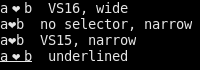

*The screen this run drew, identical to the golden. Cropped to 0,0–200,70 of the 384×160 screen.*

### `wide-deco` (tier 2): pass

Wide characters under each underline style and under strike, a decorated run mixing narrow and wide, and a decorated wide character placed in the last column. Correct: every decoration spans both cells of its wide character; the one in the last column is cut at the edge.

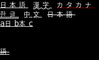

*The screen this run drew, identical to the golden. Cropped to 0,0–168,103 of the 384×160 screen.*

## Tier 3: end to end

The fork is packaged, installed in a pinned Arch Linux virtual machine and started by systemd on a virtual GPU through KMS. A script logs in, draws each screen, captures the display and compares it exactly with the golden. Images here are cropped to the drawn part of the screen.

| Case | Verdict | Pixels differing |
|---|---|---|
| [`2d-1280x800/sgr`](#2d-1280x800sgr-tier-3-pass) | pass | 0 |
| [`2d-1280x800/boxdraw`](#2d-1280x800boxdraw-tier-3-pass) | pass | 0 |
| [`2d-1280x800/cjk`](#2d-1280x800cjk-tier-3-pass) | pass | 0 |
| [`2d-1280x800/vt-switch`](#2d-1280x800vt-switch-tier-3-pass) | pass | 0 |
| [`2d-1280x800/vt-restore`](#2d-1280x800vt-restore-tier-3-pass) | pass | 0 |
| [`2d-7680x2160/sgr`](#2d-7680x2160sgr-tier-3-pass) | pass | 0 |
| [`2d-7680x2160/boxdraw`](#2d-7680x2160boxdraw-tier-3-pass) | pass | 0 |
| [`2d-7680x2160/cjk`](#2d-7680x2160cjk-tier-3-pass) | pass | 0 |
| [`2d-7680x2160/vt-switch`](#2d-7680x2160vt-switch-tier-3-pass) | pass | 0 |
| [`2d-7680x2160/vt-restore`](#2d-7680x2160vt-restore-tier-3-pass) | pass | 0 |

### Variant 2d-1280x800

kmscon drew with the drm2d backend, the bbulk renderer and the pango font engine.

#### `2d-1280x800/sgr` (tier 3): pass

SGR attributes and colours: the 16 palette colours as foreground and background, bold, underline, reverse, the 256-colour cube and a 24-bit ramp. Correct: each colour in its own cell, the cube and ramp without gaps.

Its golden changed since the previous run; this run drew the golden now exactly:

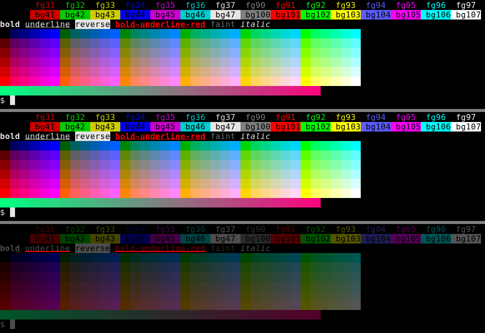

*Top to bottom: golden at 2862aeb, golden now, and the difference (the golden now dimmed, differing pixels in red; 540 pixels differ). Cropped to 0,0–968,218 of the 1280×800 screen.*

#### `2d-1280x800/boxdraw` (tier 3): pass

Box drawing and block elements, which the font renderer must join cell to cell without gaps. Correct: unbroken frames, and blocks that fill their cells.

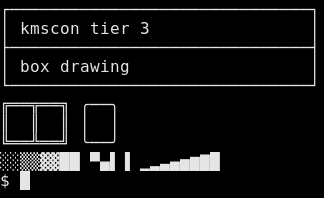

*The screen this run drew, identical to the golden. Cropped to 0,1–324,199 of the 1280×800 screen.*

#### `2d-1280x800/cjk` (tier 3): pass

Double-width CJK glyphs mixed with Latin text, drawn through pango's font fallback. Correct: each CJK character two cells wide, the bars of the last two lines aligned.

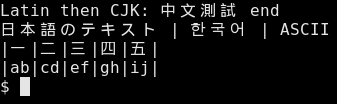

*The screen this run drew, identical to the golden. Cropped to 0,0–337,104 of the 1280×800 screen.*

#### `2d-1280x800/vt-switch` (tier 3): pass

After Ctrl+Alt+F3, the second kmscon instance on tty3 with its login prompt. Correct: a drawn screen that is neither blank nor the tty2 screen just left.

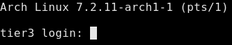

*The screen this run drew; a check with no golden. Cropped to 0,0–335,66 of the 1280×800 screen.*

#### `2d-1280x800/vt-restore` (tier 3): pass

Back on tty2 after Ctrl+Alt+F2, the cjk screen redrawn by the first instance. Correct: identical to the cjk golden.


*The screen this run drew, identical to the golden. Cropped to 0,0–337,104 of the 1280×800 screen.*

### Variant 2d-7680x2160

kmscon drew with the drm2d backend, the bbulk renderer and the pango font engine.

#### `2d-7680x2160/sgr` (tier 3): pass

SGR attributes and colours: the 16 palette colours as foreground and background, bold, underline, reverse, the 256-colour cube and a 24-bit ramp. Correct: each colour in its own cell, the cube and ramp without gaps.

Its golden changed since the previous run; this run drew the golden now exactly:

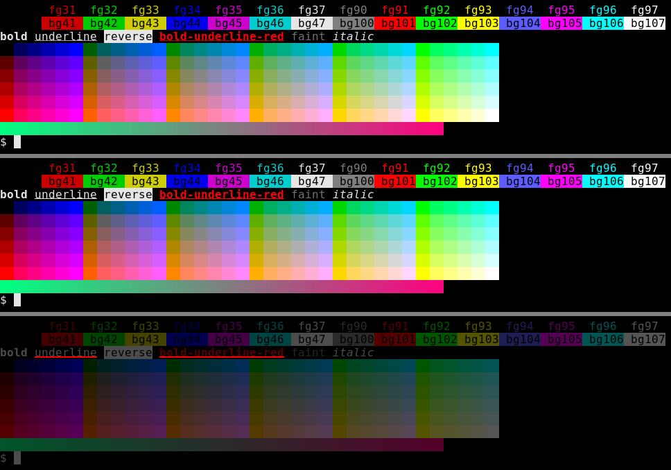

*Top to bottom: golden at 2862aeb, golden now, and the difference (the golden now dimmed, differing pixels in red; 540 pixels differ). Cropped to 0,1–968,223 of the 7680×2160 screen.*

#### `2d-7680x2160/boxdraw` (tier 3): pass

Box drawing and block elements, which the font renderer must join cell to cell without gaps. Correct: unbroken frames, and blocks that fill their cells.


*The screen this run drew, identical to the golden. Cropped to 0,6–324,204 of the 7680×2160 screen.*

#### `2d-7680x2160/cjk` (tier 3): pass

Double-width CJK glyphs mixed with Latin text, drawn through pango's font fallback. Correct: each CJK character two cells wide, the bars of the last two lines aligned.


*The screen this run drew, identical to the golden. Cropped to 0,0–337,109 of the 7680×2160 screen.*

#### `2d-7680x2160/vt-switch` (tier 3): pass

After Ctrl+Alt+F3, the second kmscon instance on tty3 with its login prompt. Correct: a drawn screen that is neither blank nor the tty2 screen just left.

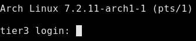

*The screen this run drew; a check with no golden. Cropped to 0,1–335,71 of the 7680×2160 screen.*

#### `2d-7680x2160/vt-restore` (tier 3): pass

Back on tty2 after Ctrl+Alt+F2, the cjk screen redrawn by the first instance. Correct: identical to the cjk golden.

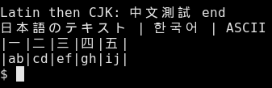

*The screen this run drew, identical to the golden. Cropped to 0,0–337,109 of the 7680×2160 screen.*
